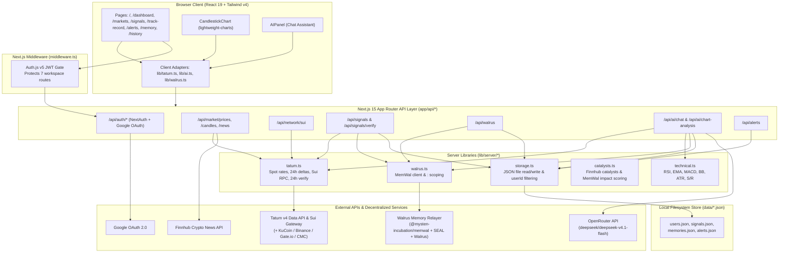

# SignalRecall — System Architecture Guide

This guide documents **SignalRecall**'s actual runtime architecture, Next.js App Router layout, server/client boundaries, data providers, local persistence model, and request flows.

---

## 1. High-Level System Architecture

---

## 2. Server / Client Boundaries & Security Model

SignalRecall enforces a strict server/client split via Next.js App Router:

| Layer | Files | Responsibilities & Security Guarantees |
| :--- | :--- | :--- |
| **Route Protection Middleware** | [`middleware.ts`](./middleware.ts) | Intercepts requests to `/dashboard`, `/markets`, `/signals`, `/history`, `/track-record`, `/memory`, and `/alerts`. Unauthenticated users are redirected to `/auth/signin?callbackUrl=...`. |
| **Auth.js v5 Core** | [`lib/auth.ts`](./lib/auth.ts), [`lib/auth.config.ts`](./lib/auth.config.ts) | Configures Google OAuth (`AUTH_GOOGLE_ID` / `GOOGLE_CLIENT_ID`), 30-day JWT sessions, `session.user.id` mapping, and `upsertUser()` persistence into `data/users.json`. |
| **Client UI & Adapters** | `app/**/page.tsx`, `components/**`, [`lib/tatum.ts`](./lib/tatum.ts), [`lib/ai.ts`](./lib/ai.ts), [`lib/walrus.ts`](./lib/walrus.ts) | Pure client components (`"use client"`). Never import `lib/server/*` or read `process.env` secrets. All external calls pass through internal `/api/*` endpoints. |
| **Server Modules** | [`lib/server/tatum.ts`](./lib/server/tatum.ts), [`lib/server/walrus.ts`](./lib/server/walrus.ts), [`lib/server/technical.ts`](./lib/server/technical.ts), [`lib/server/storage.ts`](./lib/server/storage.ts) | Hold all provider credentials (`TATUM_API_KEY`, `MEMWAL_DELEGATE_KEY`, `OPENROUTER_API_KEY`, `FINNHUB_API_KEY`), execute outbound API calls with timeouts and `cache: "no-store"`, and enforce per-user isolation. |

---

## 3. Application Routes & API Surface

### Frontend Pages (`app/**/page.tsx`)
- **`/`** ([`app/page.tsx`](./app/page.tsx)) — Public landing page with live price ticker, interactive candlestick preview, and Google Sign-In CTA. Excluded from the `AppShell` sidebar/AI panel layout ([`components/layout/AppShell.tsx`](./components/layout/AppShell.tsx)).
- **`/auth/signin`** & **`/auth/error`** — Google OAuth sign-in screen and error notice page.
- **`/dashboard`** ([`app/dashboard/page.tsx`](./app/dashboard/page.tsx)) — Overview workspace: Sui Checkpoint badge, 3 signal stat cards, `AISummaryCard`, `AIOpportunitiesCard`, `CandlestickChart` (`BTC`), `MarketOverviewCard`, and `RecentAlertsCard`.
- **`/markets`** ([`app/markets/page.tsx`](./app/markets/page.tsx)) — 6-asset live market table with search/gainers filter and Finnhub news wire.
- **`/signals`** ([`app/signals/page.tsx`](./app/signals/page.tsx)) — Trading Terminal: `LONG`/`SHORT` signal creation form, candlestick chart, and Signal Registry with **"Check 24h Status"** verification.
- **`/memory`** ([`app/memory/page.tsx`](./app/memory/page.tsx)) — Walrus Memory Bank: lists `data/memories.json` entries for the signed-in user and opens the **Store Memory** dialog.
- **`/history`** ([`app/history/page.tsx`](./app/history/page.tsx)) — Filterable (`ALL`, `TARGET_REACHED`, `INVALIDATED`, `IN_PROGRESS`) signal ledger with win-rate and PnL summary cards.
- **`/track-record`** ([`app/track-record/page.tsx`](./app/track-record/page.tsx)) — Track Record scorecard (Win Rate, Total Calls, Profit Factor, Memory Efficiency) and verified signal post-mortem ledger.
- **`/alerts`** ([`app/alerts/page.tsx`](./app/alerts/page.tsx)) — Smart Alerts workspace displaying live upcoming/recent Finnhub catalysts with Walrus-backed historical impact scores and user-tracked alerts.

### API Route Handlers (`app/api/**`)

| Endpoint | Methods | Auth Required? | Primary Modules Called | Purpose |
| :--- | :--- | :--- | :--- | :--- |
| `/api/auth/[...nextauth]` | `GET`, `POST` | Public | `lib/auth.ts` | Auth.js v5 OAuth callbacks, CSRF, and session endpoints. |
| `/api/auth/status` | `GET` | Public | `lib/auth.ts` | Returns `{ configured: isGoogleAuthConfigured() }`. |
| `/api/market/prices` | `GET` | Public | `lib/server/tatum.ts` | Returns live USD prices, 24h % changes, and volumes for `BTC`, `ETH`, `SOL`, `SUI`, `BNB`, `XRP`. |
| `/api/market/candles` | `GET` | Public | Direct exchange fetches | Returns up to 50 OHLCV candles (`1H`, `4H`, `1D`, `1W`) via KuCoin $\rightarrow$ Binance $\rightarrow$ Gate.io. |
| `/api/market/news` | `GET` | Public | Finnhub REST API | Returns up to 15 crypto headlines when `FINNHUB_API_KEY` is configured (`revalidate: 180`). |
| `/api/network/sui` | `GET` | Public | `lib/server/tatum.ts` | Returns latest Sui Mainnet checkpoint sequence number, digest, and transaction count. |
| `/api/signals` | `GET`, `POST` | Scoped if signed in | `storage.ts`, `tatum.ts`, `walrus.ts` | `GET` lists user signals; `POST` locks live entry price and ingests signal creation into Walrus Memory. |
| `/api/signals/verify` | `POST` | Owner check if `signal.userId` set | `storage.ts`, `tatum.ts`, `walrus.ts` | Evaluates `TARGET_REACHED` / `INVALIDATED` / `IN_PROGRESS` against live price + Sui checkpoint, and writes outcome to Walrus Memory. |
| `/api/walrus` | `GET`, `POST` | `POST` requires session (`401`) | `storage.ts`, `walrus.ts` | `GET` returns user memories & MemWal status (or vector recall if `?query=` is provided); `POST` commits new memory via `rememberSignalMemory()`. |
| `/api/alerts` | `GET`, `POST`, `PUT`, `DELETE` | Mutations require session (`401`) | `storage.ts`, `catalysts.ts` | Manages user-scoped alerts in `data/alerts.json` and scores custom alerts via `scoreSingleAlertWithMemory()`. |
| `/api/alerts/catalysts` | `GET` | Scoped if signed in | `catalysts.ts` | Fetches live upcoming/recent Finnhub catalysts and scores historical impact (0–100) using Walrus Memory + OpenRouter. |
| `/api/ai/chat` | `POST` | Scoped if signed in | `tatum.ts`, `technical.ts`, `walrus.ts`, `storage.ts` | Grounds OpenRouter chat completion on live prices, 4H indicators, user signals, and Walrus Memory recall. |
| `/api/ai/chart-analysis` | `POST` | Scoped if signed in | `tatum.ts`, `technical.ts`, `walrus.ts` | Computes OHLCV technical indicators, recalls Walrus Memory precedent, and requests structured JSON setup from OpenRouter. |

---

## 4. Data Providers & Market Feeds

SignalRecall aggregates live market data, candlestick series, and blockchain telemetry on the server with `cache: "no-store"`—**never** returning mock prices:

1. **Spot Rates (`lib/server/tatum.ts`):**
   - Single-symbol lookup (`fetchTatumRateResult`) queries Tatum v4 (`GET /v4/data/rate/symbol`).
   - Multi-asset batch (`fetchAllTatumRates`) queries Tatum v4 Batch (`POST /v4/data/rate/symbol/batch`).
2. **24h Deltas & Volume (`fetch24hDeltas` in `lib/server/tatum.ts`):**
   - `Binance 24hr Ticker` $\rightarrow$ `KuCoin Market Stats` $\rightarrow$ `CoinMarketCap Pro Quotes` (if `CMC_PRO_API_KEY` set).
3. **OHLCV Candlesticks (`app/api/market/candles/route.ts`):**
   - `KuCoin Candles` $\rightarrow$ `Binance Klines` $\rightarrow$ `Gate.io Spot Candlesticks` (mitigates datacenter HTTP `451` geo-blocks).
4. **Sui Mainnet Telemetry (`fetchSuiNetworkTelemetry` in `lib/server/tatum.ts`):**
   - Queries Tatum Sui Gateway RPC (`sui_getLatestCheckpointSequenceNumber`).

---

## 5. Storage Model: Local JSON vs. Walrus Memory

SignalRecall uses a dual persistence model defined in [`lib/server/storage.ts`](./lib/server/storage.ts) and [`lib/server/walrus.ts`](./lib/server/walrus.ts):

- **Local Filesystem Store (`data/*.json`):**
  - `data/users.json` — Registered Google OAuth accounts (`User`).
  - `data/signals.json` — Full `Signal` objects (`entry`, `target`, `invalidation`, `status`, `verifyAt`, `rationale`, `userId`).
  - `data/memories.json` — User-authored `Memory` cards created via `POST /api/walrus` (`title`, `body`, `outcome`, `kind`, `asset`, `userId`).
  - `data/alerts.json` — User `Alert` entries (`enabled`, `title`, `asset`, `userId`).
  - All read/filter helpers accept `userId` and return only records where `record.userId === userId`.
- **Decentralized Semantic Memory (`@mysten-incubation/memwal`):**
  - Stores vector-indexed, SEAL-encrypted memory texts on Walrus via `MEMWAL_SERVER_URL`, partitioned by `${MEMWAL_NAMESPACE}:${userId}`.
  - Used for semantic recall (`client.recall`) in AI Chat and AI Chart Analysis.

---

## 6. Key Request Flows

### Flow A: AI Chart Analysis $\rightarrow$ Signal Creation $\rightarrow$ Verification
1. User clicks **Analyze Chart with AI** in `CandlestickChart.tsx`.
2. `POST /api/ai/chart-analysis` fetches 50 KuCoin candles, gets spot price via `fetchTatumRateResult()`, computes `RSI`/`EMA`/`MACD`/`Bollinger Bands`/`ATR` in `lib/server/technical.ts`, queries `recallSignalMemories()`, and calls OpenRouter to return a `ChartAnalysisResult` JSON.
3. User clicks **Turn Into 24h Signal** $\rightarrow$ `POST /api/signals` locks fresh live spot price, writes the `Signal` to `data/signals.json`, and commits `"Signal created: ..."` to MemWal.
4. User clicks **Check 24h Status** on `/signals` $\rightarrow$ `POST /api/signals/verify` runs `verifySignalWithTatum()` (live spot price + Sui checkpoint), updates `data/signals.json` status (`TARGET_REACHED` / `INVALIDATED` / `IN_PROGRESS`), and commits the verified outcome + Sui checkpoint to MemWal.
